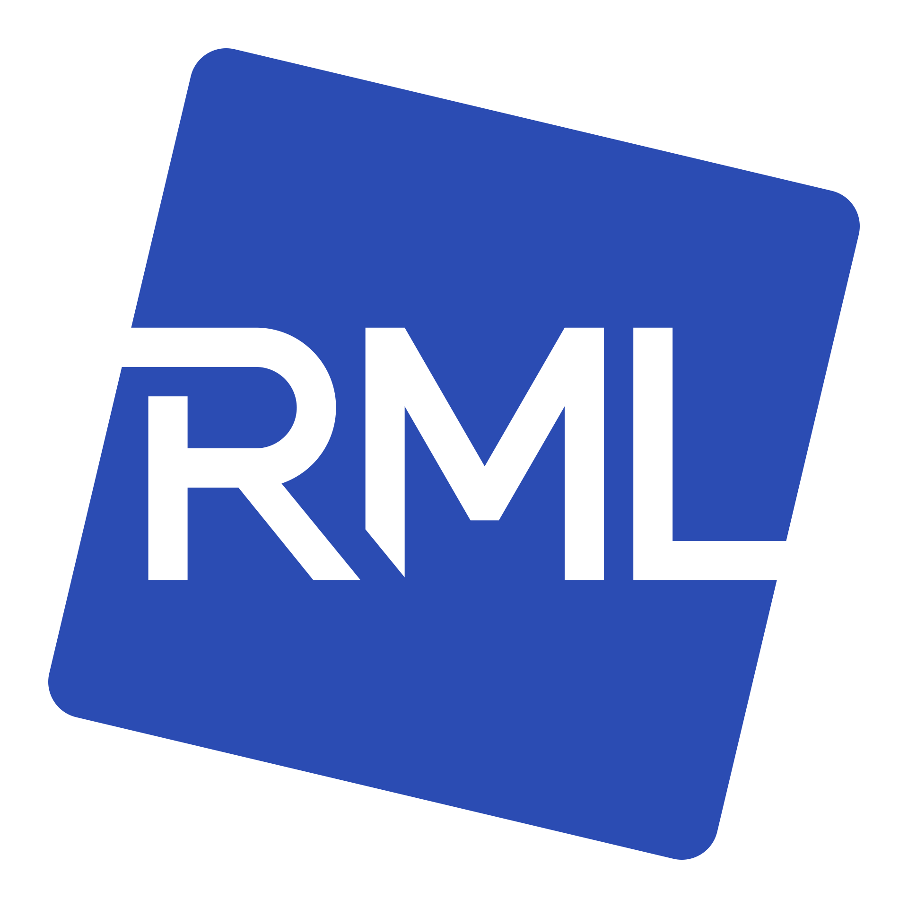

<p align="center">
  <p align="center">
    
  </p>
  <h1 align="center"><b>RML Launcher</b></h1>
  <p align="center">
    The desktop companion for <a href="https://github.com/revolutionxk/roblox-modloader">Roblox ModLoader</a> — manage Studio versions, install the mod loader and your mods, and tune engine flags from one place.
  </p>
</p>

<div align="center">


</div>

> [!NOTE]
> This project is still in development and may contain bugs or incomplete features. The launcher is being rebuilt in Flutter, and the features below return as the rewrite lands.

## Cross-Platform Support

- [x] Windows
- [x] Linux (via [Vinegar](https://github.com/vinegarhq/vinegar))
- [ ] macOS (in progress)

## What it does

- **Studio installs** — every installed Roblox Studio build is its own install with its own mod loader, mods and engine flags. Download, launch, set a default, and configure each one independently.
- **Mod Loader installer** — install, update or remove [Roblox ModLoader](https://github.com/revolutionxk/roblox-modloader) per install, straight from GitHub releases. Channels are resolved dynamically (stable, nightly, experimental, …) so new ones appear automatically. Downloads are verified by size and SHA-256.
- **Mods manager** — import mods from a `.zip` archive or a folder, enable/disable them (without deleting), remove them, and open the mods folder — scoped to each install.
- **Engine / Fast Flags** — search and edit Studio Fast Flags with per-version profiles, type detection (bool / int / string / list), diff against defaults, and snapshot import/export.

### Linux (Vinegar)

On Linux, Roblox Studio runs through [Vinegar](https://github.com/vinegarhq/vinegar). The launcher:

1. installs Vinegar via Flatpak if it is missing,
2. lets you launch Studio (Vinegar downloads it on first run),
3. installs the mod loader into Vinegar's Studio and enables the Wine `dwmapi` override, and
4. mirrors your engine Fast Flags into Vinegar's `config.toml` (`[studio.fflags]`).

## Development

### Prerequisites

- [Flutter](https://docs.flutter.dev/get-started/install) 3.47
- [CMake](https://cmake.org/download/) 3.24 or newer
- A C++20 compiler: Xcode on macOS, Visual Studio 2022 on Windows, GCC or Clang on Linux
- On Linux, the GTK development files Flutter builds against:

  ```bash
  sudo apt-get install -y clang cmake ninja-build pkg-config libgtk-3-dev
  ```

### Run

```bash
git clone https://github.com/revolutionxk/rml-launcher.git
cd rml-launcher

flutter pub get
dart run build_runner build
dart run slang
flutter run -d macos
```

Use `-d windows` or `-d linux` on those systems. The native library in `packages/rml_native` is built through CMake the first time the app or its tests run.

### Checks

```bash
flutter analyze
flutter test
```

The native library has its own Dart tests and a C++ doctest suite:

```bash
cd packages/rml_native
dart test
cmake -S . -B build/tests -DRML_NATIVE_TESTS=ON -DCMAKE_BUILD_TYPE=Release
cmake --build build/tests
ctest --test-dir build/tests --output-on-failure
```

## Tech stack

- [Flutter](https://flutter.dev/) with its own widget set, [Riverpod](https://riverpod.dev/) for state, [go_router](https://pub.dev/packages/go_router) for navigation and [slang](https://pub.dev/packages/slang) for English and Brazilian Portuguese
- A C++20 library, `rml_native`, built with CMake and called through Dart FFI

## Releases & CI

Installers and releases come back with the Velopack work.

Every pull request and push to `develop`, `main` and `feat/flutter-rewrite` runs analysis, the app and native tests, and a debug build on Windows, macOS and Linux.

## Contributing

Contributions are welcome. Please open an issue to discuss substantial changes first, keep pull
requests focused, and follow the existing code style. The launcher pairs with the main
[Roblox ModLoader](https://github.com/revolutionxk/roblox-modloader) project.

- [Discord server](https://discord.gg/revolutionxk)
- [Sponsor](https://github.com/sponsors/revolutionxk)

## License

Released under the MIT License, matching the main Roblox ModLoader project.

## Disclaimer

This project is provided for educational and research purposes. You are responsible for complying
with Roblox's Terms of Service and any applicable laws. It is not affiliated with or endorsed by
Roblox Corporation.
